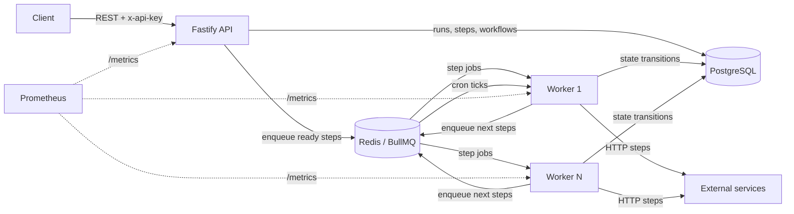

# FlowForge

[](https://github.com/Harisankar2000/flowforge/actions/workflows/ci.yml)


A **distributed job scheduler and DAG workflow engine** built with Node.js, TypeScript, Fastify, BullMQ, Redis and PostgreSQL.

You define a workflow as a graph of steps (HTTP calls, delays, logs). FlowForge runs independent steps in parallel across a pool of workers. Each step gets its own retry policy, exponential backoff and timeout. Workflows can run on a cron schedule. A run survives worker crashes and deploys, and a failed run can be resumed from the step that failed.

```text
              ┌──────────────┐
              │  fetchOrder  │
              └──────┬───────┘
          ┌──────────┴──────────┐
  ┌───────▼──────┐      ┌───────▼───────┐
  │ reserveStock │      │ chargePayment │   ← run in parallel on different workers
  └───────┬──────┘      └───────┬───────┘
          └──────────┬──────────┘
              ┌──────▼──────┐
              │  coolDown   │   ← delay step: waits in Redis, holds no worker slot
              └──────┬──────┘
              ┌──────▼──────────┐
              │ notifyCustomer  │
              └─────────────────┘
```

## Features

- **DAG workflows**: steps declare `dependsOn`. Definitions are validated on write: duplicate keys, unknown references and cycles are rejected (Kahn's algorithm).
- **Parallel, horizontally scalable execution**: stateless workers pull steps from BullMQ, so you can scale with `docker compose up --scale worker=N`.
- **Per-step retry policy**: `maxAttempts`, `fixed` or `exponential` backoff, and a timeout enforced with `AbortSignal`.
- **Smart failure handling**: 5xx, 408 and 429 responses are retried. Bad config, 4xx responses and unresolved templates fail immediately without wasting retries.
- **Dead-letter queue**: steps that exhaust their retries are recorded. `POST /runs/:id/retry` resumes the run from the failed step and keeps successful steps.
- **Cron scheduling**: timezone-aware cron triggers using BullMQ job schedulers, reconciled with the database on worker start-up.
- **Idempotency**: the `Idempotency-Key` header makes run creation safe to retry, including under concurrent requests. Cron ticks are deduplicated the same way.
- **Data passing between steps**: `{{input.x}}`, `{{steps.fetch.output.body.id}}` and `{{run.id}}` templates, with path traversal protected against prototype pollution.
- **Run cancellation**: cancels pending steps and removes their delayed or waiting jobs from Redis.
- **Production concerns**:
  - API-key auth with constant-time comparison.
  - Rate limiting and Helmet security headers.
  - Request IDs.
  - Structured logs (pino) with secrets redacted.
  - Prometheus metrics.
  - Liveness and readiness probes.
  - Graceful shutdown that lets in-flight steps finish.
  - Optional SSRF allowlist for HTTP steps.
- **OpenAPI 3.1 docs** generated from Zod schemas at `/docs`.

## Architecture



**How a run executes:**

1. `POST /workflows/:id/runs` snapshots the workflow definition into a `workflow_runs` row, with one `step_runs` row per step, in a single transaction.
2. The **orchestrator** finds steps whose dependencies have all `SUCCEEDED` and enqueues them. The orchestrator is stateless: every decision comes from the database.
3. A **worker** executes the step, then stores its output and calls the orchestrator again. This enqueues the next steps or completes the run.
4. On the final failed attempt, a single transaction does four things: marks the step `FAILED` and the run `FAILED`, marks the remaining steps `SKIPPED`, and writes a dead-letter record.

### Design decisions

| Decision                                                   | Why                                                                                                                                 |
| ---------------------------------------------------------- | ----------------------------------------------------------------------------------------------------------------------------------- |
| PostgreSQL is the source of truth; Redis only carries work | Queues can be rebuilt; run history and step outputs must be durable and queryable.                                                  |
| Deterministic job IDs (`runId__stepKey`)                   | Enqueueing is idempotent. Two workers finishing parallel branches at the same moment cannot enqueue the join step twice.            |
| Enqueue first, then mark `QUEUED`                          | If a process crashes between the two writes, the job still runs. With the opposite order the step could get stuck.                  |
| Conditional updates (`updateMany ... where status = X`)    | Gives optimistic concurrency without row locks. State transitions are race-safe across replicas.                                    |
| Definitions are snapshotted per run                        | Editing a workflow (which bumps its `version`) never changes runs that are already in flight.                                       |
| Delay steps use BullMQ delayed jobs                        | A 3-day wait costs nothing: no sleeping worker, and it survives restarts.                                                           |
| Idempotent step processing                                 | BullMQ can redeliver a stalled job after a crash. The processor detects already-completed steps and only repeats the orchestration. |
| Separate API and worker processes                          | They scale independently. A burst of HTTP requests never starves step execution.                                                    |

## Tech stack

**Runtime:** Node.js 22, TypeScript (strict), Fastify 5, Zod 4
**Data:** PostgreSQL 17 with Prisma ORM, Redis 7 with BullMQ
**Observability:** pino, prom-client (Prometheus), health probes
**Quality:** Vitest (unit and integration), ESLint, Prettier, GitHub Actions CI
**Delivery:** Docker multi-stage build (non-root), Docker Compose

## Quick start

Requires Docker.

```bash
cp .env.example .env
docker compose up -d --build          # postgres, redis, migrations, api, 2 workers
curl localhost:3000/health/ready
open http://localhost:3000/docs       # Swagger UI
```

Create a workflow and run it:

```bash
export KEY='x-api-key: dev-secret-key'

WORKFLOW_ID=$(curl -s -X POST localhost:3000/api/v1/workflows \
  -H "$KEY" -H 'content-type: application/json' \
  -d @examples/order-fulfilment.json | jq -r .id)

RUN_ID=$(curl -s -X POST localhost:3000/api/v1/workflows/$WORKFLOW_ID/runs \
  -H "$KEY" -H 'content-type: application/json' -H 'idempotency-key: order-1' \
  -d '{"input": {"orderId": 1}}' | jq -r .id)

curl -s localhost:3000/api/v1/runs/$RUN_ID -H "$KEY" | jq '{status, steps: [.steps[] | {key, status, attempts}]}'
```

Scale workers: `docker compose up -d --scale worker=5`

### Local development

```bash
npm ci
docker compose up -d postgres redis
npx prisma migrate deploy
npm run dev:api        # terminal 1
npm run dev:worker     # terminal 2
```

## Workflow definition

```jsonc
{
  "name": "user-onboarding",
  "schedule": { "cron": "0 9 * * MON-FRI", "timezone": "Asia/Kolkata" }, // optional
  "definition": {
    "steps": [
      {
        "key": "createAccount",
        "type": "http",
        "retry": { "maxAttempts": 5, "backoff": "exponential", "delayMs": 1000 },
        "timeoutMs": 10000,
        "config": {
          "method": "POST",
          "url": "https://api.example.com/accounts",
          "headers": { "authorization": "Bearer {{input.token}}" },
          "body": { "email": "{{input.email}}" },
          "expectStatus": [200, 201],
        },
      },
      {
        "key": "wait",
        "type": "delay",
        "dependsOn": ["createAccount"],
        "config": { "durationMs": 86400000 },
      },
      {
        "key": "log",
        "type": "log",
        "dependsOn": ["wait"],
        "config": { "message": "Account {{steps.createAccount.output.body.id}} onboarded" },
      },
    ],
  },
}
```

| Step type | Config                                             | Output                      |
| --------- | -------------------------------------------------- | --------------------------- |
| `http`    | `method`, `url`, `headers`, `body`, `expectStatus` | `{ status, headers, body }` |
| `delay`   | `durationMs` (up to 7 days)                        | `{ delayedMs }`             |
| `log`     | `message`, `level`                                 | `{ message }`               |

Adding a step type takes two changes: a Zod schema in `src/engine/definition.ts` and an executor implementing `StepExecutor` in `src/engine/executors/`. The engine itself does not change.

## API

All `/api/v1` routes require the `x-api-key` header. Full schemas are at `/docs`.

| Method   | Path                                        | Description                                                                  |
| -------- | ------------------------------------------- | ---------------------------------------------------------------------------- |
| `POST`   | `/api/v1/workflows`                         | Create a workflow (validates the DAG and cron)                               |
| `GET`    | `/api/v1/workflows`                         | List workflows (`page`, `pageSize`, `search`, `isActive`)                    |
| `GET`    | `/api/v1/workflows/:id`                     | Get a workflow, including its next scheduled run                             |
| `PATCH`  | `/api/v1/workflows/:id`                     | Update a workflow; changing the definition bumps its version                 |
| `DELETE` | `/api/v1/workflows/:id`                     | Delete a workflow, its schedule and its runs                                 |
| `POST`   | `/api/v1/workflows/:id/runs`                | Trigger a run (`Idempotency-Key` supported): `202` if new, `200` if replayed |
| `GET`    | `/api/v1/workflows/:id/runs`                | List runs (`status` filter)                                                  |
| `GET`    | `/api/v1/runs/:id`                          | Run details with every step's status, attempts, input and output             |
| `POST`   | `/api/v1/runs/:id/cancel`                   | Cancel a pending or running run                                              |
| `POST`   | `/api/v1/runs/:id/retry`                    | Resume a failed run from its failed step                                     |
| `GET`    | `/api/v1/dead-letters`                      | Steps that exhausted their retries                                           |
| `GET`    | `/health/live`, `/health/ready`, `/metrics` | Probes and Prometheus metrics (public)                                       |

Every error response has the same shape:

```json
{ "error": { "code": "VALIDATION_ERROR", "message": "...", "details": [], "requestId": "..." } }
```

## Testing

```bash
npm test                    # unit tests
npm run test:integration    # end-to-end against real Postgres + Redis (docker compose up -d postgres redis)
npm run test:coverage
```

The integration suite starts the API and an in-process worker against a local HTTP server. It verifies:

- DAG ordering and data passing between steps
- retry with backoff
- dead-lettering and resuming a failed run
- fail-fast on non-retryable errors
- concurrent idempotent triggers
- cancelling a delayed run
- auth, validation errors and cron registration

## Project structure

```text
src/
├── config/           # Environment loading and validation (Zod)
├── engine/           # Core engine: framework-agnostic and unit-testable
│   ├── dag.ts            # Validation, topological sort, ready-step resolution
│   ├── definition.ts     # Workflow and step schemas
│   ├── template.ts       # {{...}} resolution between steps
│   ├── orchestrator.ts   # Stateless run state machine
│   ├── step-processor.ts # Executes one attempt of one step
│   ├── scheduler.ts      # Cron schedules
│   ├── queues.ts         # BullMQ queues and job IDs
│   └── executors/        # Pluggable step types (http, delay, log)
├── modules/          # Feature modules: schemas → routes → service → repository
│   ├── workflows/
│   ├── runs/
│   ├── dead-letters/
│   └── health/
├── http/             # Fastify app factory and plugins (auth, errors, swagger)
├── lib/              # Shared utilities (logger, errors, metrics, pagination, ...)
├── container.ts      # Composition root (dependency injection)
├── server.ts         # API entry point
└── worker.ts         # Worker entry point
```

## Roadmap

- Conditional steps (`runIf`) and `continueOnFailure`
- Fan-out / map steps over arrays
- Per-workflow concurrency limits
- OpenTelemetry tracing across API and workers
- A web dashboard for runs

## License

MIT © Harisankar Sahoo
